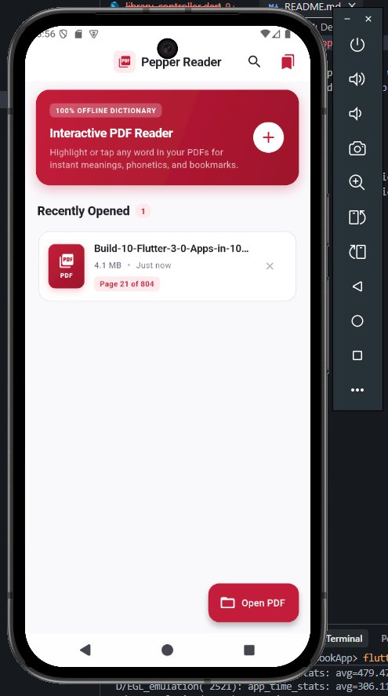

# Pepper Reader (EbookApp)

[](https://flutter.dev)
[](#architecture)
[](#offline-dictionary)
[](LICENSE)

An offline E-Book and PDF Reader built with Flutter, featuring an embedded **102,217-word offline Webster's dictionary**, seamless in-document word definition lookups, persistent reading progress tracking, vocabulary bookmarks, and interactive 3D flashcards.

Available in two purpose-built versions: **Mobile** (Android & iOS) and **Desktop** (Windows, macOS, Linux).

---

## 📱 Mobile App Preview

<p align="center">
  
</p>

---

## ✨ Key Features

- **100% Offline English Dictionary:** Embedded SQLite database with **102,217 indexed words**, phonetics, parts of speech, definitions, example sentences, and synonyms.
- **Local PDF Document Reader:** Open any `.pdf` file from your device storage with instant page rendering via `pdfrx`.
- **Instant In-Document Word Lookup:** Tap or highlight any word in a PDF and tap **"Define"** to inspect its full meaning without switching apps.
- **Adaptive Definition Bottom Sheet:**
  - **Short definitions:** Intelligently wrap content at the bottom of the screen without taking up unnecessary screen space.
  - **Long definitions:** Smoothly scroll within a constrained 85% viewport, completely preventing RenderFlex overflow issues.
- **Reading Progress Tracker:** Automatically tracks your recently opened documents, last-read page numbers, total pages, and percentage completion.
- **Saved Vocabulary & Bookmarks:** Star words directly from the reader or search bar for offline study.
- **3D Flip Flashcards:** Revision mode using smooth 3D flip card animations to test and reinforce vocabulary knowledge.
- **Dedicated Desktop Version:** Tailored dual-pane layout with persistent sidebar navigation, Ctrl+O shortcuts, and a side-by-side dictionary inspector panel.

---

## 📂 Repository Structure

```text
EbookApp/
├── Mobile/                         # Flutter Mobile Project (Android & iOS)
│   ├── assets/data/dictionary.db   # 102,217 indexed words SQLite database
│   ├── lib/
│   │   ├── controllers/            # MVC Controllers (ChangeNotifiers)
│   │   │   ├── dictionary_controller.dart
│   │   │   ├── flashcard_controller.dart
│   │   │   ├── library_controller.dart
│   │   │   ├── onboarding_controller.dart
│   │   │   └── reader_controller.dart
│   │   ├── models/                 # Data models (WordDefinition, RecentPdf, etc.)
│   │   ├── services/               # DatabaseService & file helpers
│   │   ├── views/                  # UI screens & reusable widgets
│   │   │   ├── dictionary/         # DictionaryBottomSheet, Search, Study
│   │   │   ├── library/            # LibraryScreen & RecentPdfCard
│   │   │   └── reader/             # PdfReaderScreen
│   │   └── main.dart
│   ├── test/                       # Unit & Widget test suite
│   └── pubspec.yaml
│
├── Desktop/                        # Flutter Desktop Project (Windows, macOS, Linux)
│   ├── assets/data/dictionary.db
│   ├── lib/
│   │   ├── views/desktop/          # DesktopShellScreen, DesktopPdfReaderView,
│   │   │                           # DesktopDictionaryPanel, DesktopLibraryView
│   │   └── main.dart               # sqflite_common_ffi desktop initialization
│   ├── test/                       # Desktop widget & model tests
│   └── pubspec.yaml
│
└── docs/screenshots/               # Project screenshots & assets
```

---

## 🏗️ Architecture: Strict MVC + Provider

The codebase strictly adheres to the **Model-View-Controller (MVC)** architectural pattern:

- **Models (`models/`):** Pure Dart data classes with immutable fields, `toMap`, `fromMap`, and `copyWith` serialization methods.
- **Controllers (`controllers/`):** `ChangeNotifier` classes that hold business logic, manage state, and interact with services. Views never execute business logic or direct database queries.
- **Views (`views/`):** Clean Flutter widgets consuming controllers via `Consumer` or `context.watch<T>()`.
- **Services (`services/`):** Singleton database services managing offline SQLite operations via `sqflite` (Mobile) and `sqflite_common_ffi` (Desktop).

---

## 🚀 Getting Started

### Prerequisites

- [Flutter SDK](https://docs.flutter.dev/get-started/install) 3.10.0 or higher
- Dart SDK 3.0.0 or higher
- Android Studio / Xcode (for mobile development)
- Visual Studio C++ Build Tools (for Windows desktop)

### Running the Mobile Version

```bash
cd Mobile
flutter pub get
flutter run
```

### Running the Desktop Version (Windows)

```bash
cd Desktop
flutter pub get
flutter run -d windows
```

### Running Tests

To verify models, controllers, and UI widgets:

```bash
# Mobile tests
cd Mobile
flutter test

# Desktop tests
cd Desktop
flutter test
```

### Code Quality & Analysis

```bash
cd Mobile
flutter analyze

cd ../Desktop
flutter analyze
```

---

## 🎨 Theme & Branding

- **Primary Brand Color:** Pepper Red (`#C41E3A`)
- **Accent Soft:** `#FDF2F4`
- **Badge Fill:** `#F5F6F8`
- **Typography:** Modern clean sans-serif with clear semantic hierarchy

---

## 👤 Author

Developed by **eyahAsuquo** ([eyahasuquo@gmail.com](mailto:eyahasuquo@gmail.com)).
GitHub: [@eyahAsuquo](https://github.com/eyahAsuquo)
